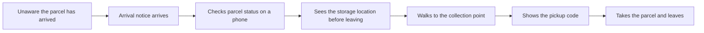
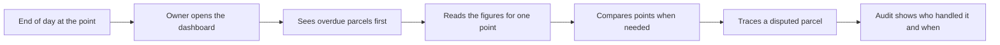
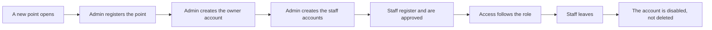

# User Journey Maps

## Community Parcel Collection Point Management System

| Item | Detail |
|---|---|
| Task | T-10-04 |
| Owner | R4 (design), reviewed by R2 |
| Version | v1.0 |
| Status | Complete for Sprint 1 |
| Source | Derived from `survey-results.md` and `Personas.md` in this folder |
| Related | `docs/02-design/frontend-page-map.md`, SRS sections 1.5 and 2.3 |

> The SRS has referenced `user-journey-maps.md` since its first draft, but the
> file was never created. This document closes that reference.
>
> Every stage below is traceable either to an answer in one of the four role
> questionnaires or to a decision the team has already recorded. Nothing here
> adds a feature that the survey did not support.

## 1. How to read these maps

Each map follows one role from the event that starts the work to the point where
that role is finished. Every stage answers four questions.

| Column | Question it answers |
|---|---|
| Stage | Where in the flow are we |
| What the person does | The action they take, in their own terms |
| What the system does | The response the system has to produce |
| Target or evidence | The measured expectation, and where it came from |

The same two limits that apply to `survey-results.md` apply here.

1. The survey was convenience sampling. These maps describe the roles as the
   people who answered described them, not as a whole population.
2. The administrator group returned four responses, so the administrator map is
   indicative only.

## 2. The actors

| Actor | Has a login | Map |
|---|---|---|
| Resident | Yes | 3.2 |
| Staff | Yes | 3.3 |
| Owner | Yes | 3.4 |
| System administrator | Yes | 3.5 |
| Courier | **No** | Appears in the staff map as an external event only |

The courier delivers to the counter and staff record what the courier brought. A
courier account is deliberately out of scope: no respondent in any group
described a courier logging in, and the SRS records this in section 1.5.

## 3. The maps

### 3.1 One parcel, end to end

#### Flow Diagram(One Parcel End To End)

```mermaid
flowchart LR
    A[Courier drops a batch at the counter] --> B[Staff records the batch]
    B --> C[System suggests a storage location]
    C --> D[Staff accepts or overrides it]
    D --> E[Parcel is shelved and marked as stored]
    E --> F[Resident is notified]
    F --> G[Resident opens the parcel list]
    G --> H[Resident arrives with the pickup code]
    H --> I[Staff verifies the code]
    I --> J[Handover is confirmed and recorded]
```

The four maps below expand the parts of this line that one role owns.

### 3.2 Resident journey, from unaware to collected

Trigger: a parcel addressed to the resident reaches the collection point and the
resident has not been told.

#### Flow Diagram(Resident Parcel Pickup)

| Stage | What the resident does | What the system does | Target or evidence |
|---|---|---|---|
| 1. Waiting | Carries on with the day, not expecting anything | Records the parcel as stored and issues a pickup code | Arrival notice: five minutes is the design target, one hour is the acceptable limit (R4: 6 of 11 wanted five minutes, 9 of 11 wanted within the hour) |
| 2. Notified | Reads the notice on a phone | Sends an in-system notification naming the collection point | Notification was the most chosen function (R5: 4 of 11) |
| 3. Checking | Opens the parcel list to see what is waiting | Lists every parcel for that resident with its status | Status and location visibility together were chosen by 5 of 11 (R5: status 3, location 2) |
| 4. Deciding | Looks at the storage location before walking over | Shows the storage location and the pickup code on the parcel detail page | Not knowing where the parcel is was a stated problem (R3: 2 of 11, plus a further 3 of 11 for hard to find) |
| 5. Collecting | Arrives at the counter and shows the pickup code | Keeps the pickup code single use and verifies it | All 11 accept a collection of up to ten minutes, and about half expect three to five (R6) |
| 6. Finished | Takes the parcel and leaves | Records the handover and closes the parcel | Handover confirmation is a must-have staff function (S4: 3 of 7) |

Design routes: `/my-parcels` for stage 3, `/my-parcels/:id` for stage 4.

**What this journey must not contain**

- A delegated collection code as a normal step. Nobody chose it (R5: 0 of 11), so
  it stays deferred.
- Any step that assumes the resident remembers the interface. Most respondents
  receive parcels monthly or less often (R1: 6 of 11), so the journey has to work
  for someone who opens it a few times a month.
- Any step that only works on a desktop. 9 of 11 use a phone (R2).

### 3.3 Staff journey, from a trolley at the counter to a completed handover

Trigger: a courier arrives with a batch of parcels.

#### Flow Diagram(Staff Intake And Handover)

```mermaid
flowchart LR
    A[Courier arrives with a batch] --> B[Staff opens the intake form]
    B --> C[Records the batch in one operation]
    C --> D[System suggests a location]
    D --> E[Staff keeps control of the final position]
    E --> F[Parcel is shelved]
    F --> G[Resident arrives with a code]
    G --> H[Staff enters the pickup code]
    H --> I[Identity is confirmed]
    I --> J[Handover is recorded against the parcel]
```

| Stage | What the staff member does | What the system does | Target or evidence |
|---|---|---|---|
| 1. Receiving | Takes a trolley of parcels from the courier | Nothing yet, the batch has not been entered | Most points represented are small: 20 to 50 parcels a day (S1: 4 of 7) |
| 2. Registering | Enters the batch rather than one parcel at a time | Accepts a batch, recognises the carrier from the waybill prefix, rejects a duplicate waybill | Batch registration is the single largest delay (S3: 4 of 7) |
| 3. Positioning | Shelves each parcel and keeps the final say on where it goes | Suggests a storage location the staff member can accept or override | Recommendation was chosen by nobody (S4: 0 of 7) and 4 of 7 preferred manual control or no suggestion (S5) |
| 4. Waiting | Serves other residents | Holds the parcel as stored and has already notified the resident | Notification is what residents value most (R5: 4 of 11) |
| 5. Verifying | Asks for the pickup code and checks the person | Validates the code as single use and shows the parcel it belongs to | Pickup code verification was a top staff function (S4: 3 of 7) |
| 6. Handing over | Gives the parcel to the right person and moves on | Records the handover so it can be traced later | Up to three minutes per handover (S6: 6 of 7 accept this) |

Design routes: `/parcels/new` for stage 2, `/locations` for stage 3, `/pickup`
for stages 5 and 6.

**What this journey must not contain**

- Automatic location assignment. The system must never shelve a parcel without
  the staff member confirming the position.
- Any design that assumes the shelves are hard to search. Searching the shelves
  was named as a delay by nobody (S3: 0 of 7), so it is not the problem to solve.
- Registering parcels one at a time as the only option. That is the bottleneck
  the system exists to remove.

### 3.4 Owner journey, from daily figures to a defensible answer

Trigger: the end of the day, or a resident disputing a handover.

#### Flow Diagram(Owner Overdue And Dispute Review)

| Stage | What the owner does | What the system does | Target or evidence |
|---|---|---|---|
| 1. Reviewing | Checks the point at the end of the day | Shows incoming, collected and overdue figures | Overdue parcels is the dominant report (O3: 6 of 7) |
| 2. Following up | Chases parcels that have been sitting too long | Lists overdue parcels for the point | 6 of 7 chose overdue parcels over every other report |
| 3. Comparing | Checks how the other points are doing | Compares activity across the points the owner holds | 6 of 7 manage more than one point and 6 of 7 want cross-point comparison (O1, O4) |
| 4. Investigating | Answers a resident who says a parcel went missing | Shows the parcel handling history grouped by parcel or storage location | 4 of 7 want the audit log grouped by the object, not by time (O6) |
| 5. Acting | Manages the staff account involved | Lets the owner manage staff accounts for their own points | Viewing reports is the owner's main permission (O5: 4 of 7), followed by managing staff (2 of 7) |

Design routes: `/dashboard` and `/reports` for stages 1 to 3, `/audit` for
stage 4, `/users` for stage 5.

Cross-point comparison stays a should-have. Every point has to be usable on its
own first (survey-results.md, conclusion 2).

### 3.5 System administrator journey, from a new point to a closed account

Trigger: a new collection point opens, or a member of staff leaves.

#### Flow Diagram(Administrator Account Lifecycle)

| Stage | What the administrator does | What the system does | Target or evidence |
|---|---|---|---|
| 1. Setting up a point | Registers a new collection point and its zones and storage locations | Keeps each point's data separated by a site identifier in one deployment | 3 of 4 chose a shared database with a site identifier (A5), which agrees with ADR-002 |
| 2. Creating accounts | Creates the owner account, then the first staff accounts | Enforces one role model for every account | Self-registration with approval was chosen by 3 of 4 (A2) |
| 3. Approving | Approves or rejects a registration | Applies role-based access control as the primary defence | RBAC was the most chosen security control (A4: 2 of 4) |
| 4. Configuring | Sets what differs between points | Allows per-point configuration of storage hours, notification rules and location layout | Storage hours was chosen by 2 of 4, notification rules and location layout by 1 each (A6) |
| 5. Offboarding | Disables the account when someone leaves | Disables rather than deletes, so historical records keep their author | The administrator map is indicative only, since the group returned four responses |

Design routes: `/settings` for stages 1 and 4, `/users` for stages 2, 3 and 5.

## 4. Steps deliberately outside every map

| Excluded step | Why |
|---|---|
| Courier logs in or uses the system | Couriers deliver to the counter and staff record the delivery. No respondent described a courier account, and the SRS lists this as out of scope. |
| The system controls hardware | The deliverable is a web application. There is no cabinet, no lock and no scanner. |
| Taking a payment or charging an overdue fee | Fee configuration was chosen by nobody (A6: 0 of 4). Billing is deferred until the team discusses it. |
| A resident authorises somebody else to collect | The delegated collection code was chosen by nobody (R5: 0 of 11). It stays deferred rather than assumed. |
| The system chooses the shelf position on its own | Location recommendation was chosen by nobody (S4: 0 of 7) and 4 of 7 wanted manual control. A suggestion is allowed, an automatic assignment is not. |

## 5. What the maps imply for the front end

Every stage maps onto a page that already exists in
`docs/02-design/frontend-page-map.md`. No page has to be added.

| Map | Stage | Route | Priority |
|---|---|---|---|
| Resident | 3, 4 | `/my-parcels`, `/my-parcels/:id` | P0 |
| Staff | 2 | `/parcels/new` | P0 |
| Staff | 3 | `/locations` | P0 |
| Staff | 5, 6 | `/pickup` | P0 |
| Owner | 1 to 3 | `/dashboard`, `/reports` | P0 for `/dashboard`, P1 for `/reports` |
| Owner | 4 | `/audit` | P1 |
| Owner | 5 | `/users` | P1 |
| Administrator | 1, 4 | `/settings` | P1 |
| Administrator | 2, 3, 5 | `/users` | P1 |

The mobile-first requirement comes from the resident map: the resident stages
have to work at a phone width, and the staff and owner stages have to remain
usable on a phone during a shift.

## 6. Open points

| Item | Why it is still open |
|---|---|
| The retention period before a parcel counts as overdue | The survey did not ask for a number. Three days is recorded as an assumption, pending the billing discussion. |
| Whether an owner in a small point also works as staff | OI-2 in the SRS. The glossary records that the two roles can be combined in one person. |
| The identification fallback when a resident has lost the pickup code | Not asked in the survey. `survey-results.md` proposes phone number plus surname as a documented fallback. |
| SRS assumption A4 | It still describes the personas and these maps as AI-simulated. The personas are now derived from the survey, and these maps are derived from the same data, so that line needs updating. |

## Revision history

| Version | Week | Change | Author |
|---|---|---|---|
| v1.0 | Week 2 | Initial journey maps for the four roles, derived from the survey results and the personas. `CR-013` is the change record that named this file | R4 |
