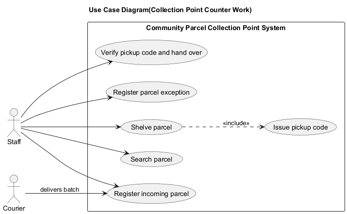
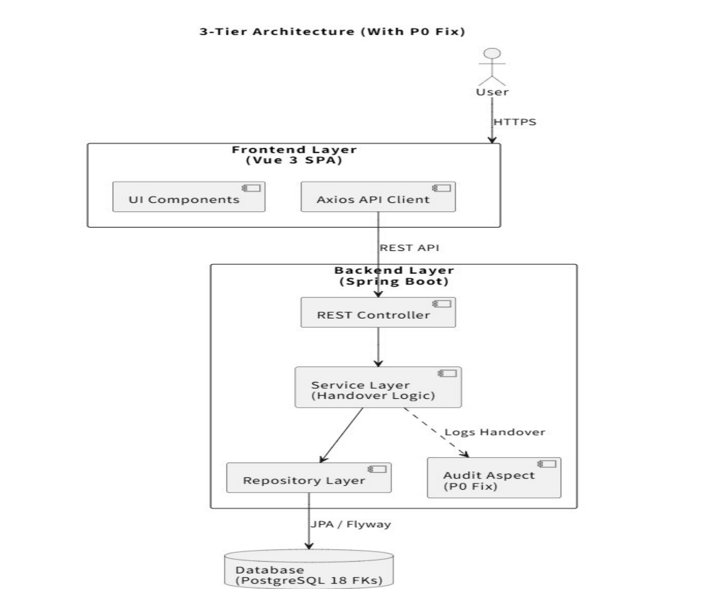

https://github.com/Django-coder6/3500SEF-Group23-Project-LMS

# Community Parcel Collection Point Management System

**COMP 3500SEF Group 23 | 8 December 2026**

## 1. Introduction and Scope

Community collection points receive parcels in bulk for local residents. Staff at the studied point use spreadsheets, existing software and chat histories, so one parcel can exist in three records and no one can reliably answer where it is or who collected it. Four role-specific questionnaires (29 responses) confirmed the problem but ranked pains differently: residents wanted timely notification, while staff wanted faster intake. The project therefore delivers a staff counter slice: register a parcel, put it away, issue a pickup code, verify that code and record one handover. We use the term *shelving* for the physical put-away plus the system location record, and *handover* for verification plus the audit row. The assessed release is this vertical slice, not the whole product.

## 2. Process

We used a hybrid incremental and plan-driven process across five sprints. A fixed SRS and architecture baseline plus a change log protected reviewability; a product backlog and two-week increments allowed learning. Every task had an owner, folder and required artefact, and a Wednesday checkpoint, Sunday logbook and non-author pull-request review made progress visible. Waterfall would have frozen uncertain scope; pure Scrum would have produced too little evidence for the assessment. The main process risk, RSK-01, was that eight weeks left no buffer. When requirements moved in week 3, we protected the transactional slice and recorded the cuts instead of hiding them.

| Sprint | Weeks | Goal | Tag |
|---|---|---|---|
| 0 | 1 | repository, research, competency review | v0.0.1 |
| 1 | 2 | requirements and design baseline | v0.1.0 |
| 2 | 3-4 | intake, shelving and pickup end to end | v0.2.0 |
| 3 | 5-6 | progress review, hardening and evidence | v0.3.0 |
| 4 | 7-8 | test pass, report, presentation and logbooks | v1.0.0 |

*Figure 1: Hybrid five-sprint cadence. The vertical slice was protected when requirements moved.*

## 3. Requirements Engineering

Requirements came from four role-specific questionnaires (29 responses: 11 residents, 7 staff, 7 owners and 4 administrators), followed by personas and journey maps. The SRS contains 47 functional and 14 non-functional requirements. MoSCoW prioritisation produced a 32-requirement product Must baseline, and the RTM maps each Must to a design artefact and a reserved test identifier; implementation status is a separate column. That separation prevents *mapped* from being read as *built*. Table 1 gives representative requirements and evidence. Seven Musts are implemented in this release; the rest are designed, deferred or explicit gaps. For example, CR-004 demoted location recommendation after 0 of 7 staff selected it, and CR-005 excluded delegated collection after 0 of 11 residents selected it. The Must baseline is a priority list, not a delivery list; the release slice is the riskiest end-to-end transaction, not a random subset.

| ID | Requirement | Priority | Status | Evidence |
|---|---|---|---|---|
| FR-12 | Register one parcel with one location and one code | Must | Implemented | ST-SYS-001 |
| FR-21 | Verify a pickup code before handover | Must | Implemented | ST-SYS-003 |
| FR-22 | Record exactly one handover | Must | Implemented | ST-SYS-003 |
| NFR-4 | Repeat confirmation returns the same handover | Must | Implemented | ST-SYS-003 |

*Table 1: Representative requirements. Status is separate from priority; mapped is not built.*

## 4. System Modeling

The use-case model scopes the staff counter: register a parcel, shelve it, verify a code and hand over, with pickup-code issue included in shelving. Exception registration is designed but not built, and search/list is a recorded gap (issue 289); a diagram that claimed the whole product would hide those gaps. The FR-12 sequence model shows the success path and two alternatives: a duplicate waybill returns 409, and no free location follows the CR-029 contract path of registering first and assigning a location later. The parcel state model reduces seven candidate states to registered, shelved and collected because courier states lie outside the system boundary; illegal transitions return 422. These models exposed a reachability defect: tests inserted *shelved* directly, so they passed while the application could not reach that state. Modeling therefore changed both design and tests.

*Figure 2: Staff-counter use-case baseline. Search and exception registration are recorded gaps, not released behaviour.*

## 5. Architecture and Design

ADR-002 selects a layered monolith: Vue 3 SPA, REST/OpenAPI, Spring Boot controller-service-repository, PostgreSQL and Flyway, plus an audit aspect. Microservices were rejected because the team had eight weeks and because handover must update parcel, location and audit in one transaction; distributing that transaction would add failure modes without a user benefit. The schema has nine tables and eighteen foreign keys, and the audit aspect writes one row per handover. Contract-first design froze OpenAPI before frontend feature work, allowing parallel work and making missing operations visible: six operations are specified but not built. The architecture is a deliberate trade-off between deployability and transactional integrity.

*Figure 3: Layered architecture. The audit aspect is inside the same transaction boundary.*

## 6. Implementation

The implemented slice is one request, one transaction. `POST /parcels` inserts the parcel, occupies the location and issues the pickup code; `POST /pickup/verify` returns the parcel or an error; `POST /pickup/confirm` records one handover and frees the location. A used code returns 404 `PICKUP_CODE_USED`, while a repeat confirm returns 200 with the same handover (NFR-4). Duplicate waybills return 409 and keep one row. The UI exposes the code once, and the audit aspect records the operator. Implementation stopped at the slice boundary: resident reads and admin/report pages remain contract-only or placeholders and are recorded as gaps rather than presented as complete.

## 7. Testing and Validation

Every pull request ran lint, 90 backend tests, 68 frontend tests and a Docker smoke test; 35 Testcontainers tests across 7 classes exercised real PostgreSQL. Line coverage was 88.79% and branch coverage 64.64% on CI run 43009104923. Three system tests and three first-time-user acceptance observations passed; acceptance times are estimates, not measured benchmarks. Testing found a P0 reachability defect: handover tests had inserted *shelved* directly, masking the missing application path. The defect was fixed and linked to CR-034 to CR-036. Validation remains limited: there is no full end-user acceptance test, some failure paths are partial, and the sample is convenience-based. We report these limits rather than claiming 100% coverage.

| Requirement | Design | Endpoint | Code | Test | CI |
|---|---|---|---|---|---|
| FR-12 | sequence-staff-intake.puml | POST /parcels | ParcelRegistrationService | ParcelRegistrationIntegrationTest | 43009104923 |

*Figure 4: Traceability chain for FR-12, from requirement to CI evidence (run 43009104923).*

## 8. Software Evolution

Change is recorded in 37 CRs. CR-006 reduced seven parcel states to three; CR-028 and CR-029 removed a pending-slot concept the schema could not represent and made `locationId` optional; CR-033 made handover idempotent and aligned NFR-4 with the implementation; CR-034 to CR-036 record reachability fixes. The log is a decision record, not decoration: later records correct earlier ones, and each links to code, tests or API changes. The risk register closes a risk only with evidence. This is how the project handled evolution after the baseline moved.

## 9. Conclusion and Reflection

The project delivered a defensible staff intake-to-handover slice, not the full product. The main lessons are to freeze requirements and write the RTM before design, and to prove reachability end-to-end earlier; both would have reduced late contract movement. The report limits its claims to evidence in the repository.

**Body word count: 947 (within the 1000-word limit).**
